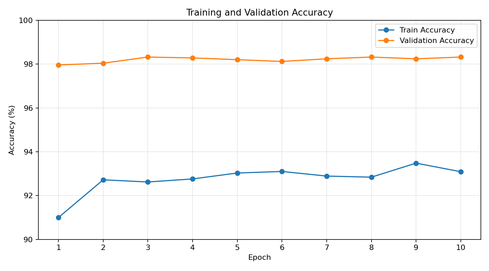
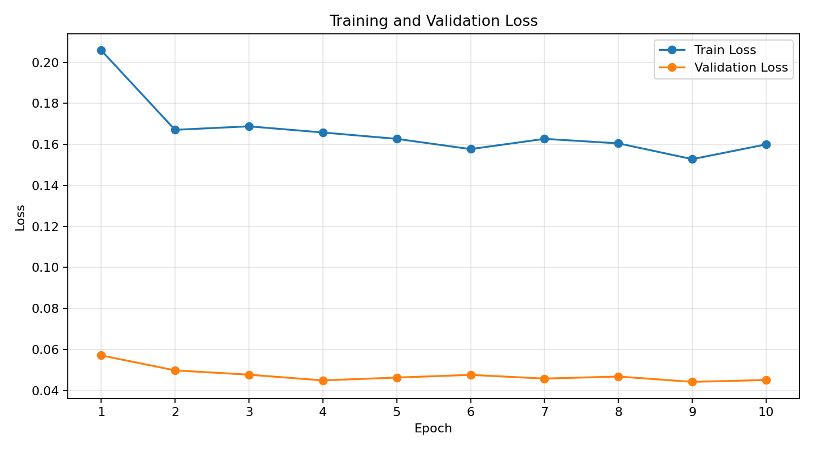

# 🐱 Cats vs Dogs Image Classification

딥러닝 기반 이미지 분류 모델을 활용하여 사용자가 업로드한 이미지가 **강아지인지 고양이인지 판별하는 웹 애플리케이션**입니다.

PyTorch를 활용하여 이미지 분류 모델을 직접 학습하고, FastAPI 백엔드와 Next.js 프론트엔드를 연결하여 실제 웹 환경에서 이미지 분류 서비스를 구현했습니다.

---

## 1. 프로젝트 개요

### 1-1. 프로젝트 소개

사용자가 이미지를 업로드하면 학습된 AI 모델이 이미지를 분석하여 강아지 또는 고양이로 분류하고, 각 클래스에 대한 예측 확률을 제공합니다.

단순히 모델을 학습하는 것에서 끝나지 않고, 학습한 모델을 API 서버에 적용하고 웹 애플리케이션과 연동하여 실제 서비스 형태로 구현하는 것을 목표로 합니다.

### 1-2. 주요 기능

- 이미지 업로드 및 미리보기
- AI 모델을 활용한 강아지 / 고양이 이미지 분류
- FastAPI를 통한 이미지 분류 API 제공

---

## 2. 프로젝트 환경 및 구조

### 2-1. 개발 환경

| 구분 | 기술 |
|---|---|
| Frontend | Next.js |
| Language | TypeScript |
| Backend | Python |
| API Framework | FastAPI |
| AI Framework | PyTorch |
| AI Model | ResNet18 |
| Image Processing | Pillow, Torchvision |
| Deployment (Frontend) | Vercel |
| Deployment (Backend) | Render |
| Version Control | Git / GitHub |

### 2-2. 프로젝트 폴더 구조

```text
dogs_vs_cats_web/
│
├── frontend/
│   ├── public/
│   │
│   └── src/
│       ├── api/           # API 요청 및 통신 관리
│       ├── app/           # Next.js 애플리케이션 설정
│       ├── hooks/         # 커스텀 React Hooks
│       └── page/          # 페이지 및 화면 구성
│
├── backend/
│   ├── api/
│   │   ├── endpoints/     # API 엔드포인트
│   │   ├── config.py      # API 공통 설정
│   │   └── middleware.py  # 공통 미들웨어 설정
│   │
│   ├── app/
│   │   ├── main.py        # FastAPI 애플리케이션 진입점
│   │   ├── model.py       # AI 모델 로딩 및 추론
│   │   └── transform.py   # 이미지 전처리
│   │
│   └── models/
│       └── cat_dog_classifier.pth  # 학습된 모델 가중치
│
└── README.md
```

### 2-3. API 명세

| Method | Endpoint | 설명 |
|---|---|---|
| POST | `/predict` | 이미지 업로드 및 AI 분류 |

**이미지 분류 API**

- Request: `multipart/form-data`
- Parameter: `file`
- 지원 이미지 형식: JPG, PNG, WEBP
- 최대 업로드 용량: 10MB

---

## 3. 프로젝트 배포

프론트엔드와 백엔드를 분리하여 각각 Vercel과 Render를 통해 배포했습니다.

### 3-1. 배포 환경

| 구분 | 플랫폼 | 배포 주소 |
|---|---|---|
| Frontend | Vercel | https://cat-dog-classifier-seven.vercel.app/ |
| Backend | Render | https://cat-dog-classifier-dxua.onrender.com |

### 3-2. Frontend 배포 (Vercel)

Next.js 프로젝트를 GitHub 저장소와 연결하여 Vercel에 배포했습니다.

---

## 4. AI 모델링 학습 결과

### 4-1. 모델 학습 환경

| 항목 | 내용 |
|---|---|
| Framework | PyTorch |
| Model | ResNet18 |
| Dataset | Kaggle Dogs vs Cats |
| Task | Binary Image Classification |
| Number of Classes | 2 |
| Class 0 | Cat |
| Class 1 | Dog |
| Output Layer | 2 |

### 4-2. 학습 결과 요약

총 10 Epoch 학습을 진행한 결과입니다.

| 항목 | 결과 |
|---|---:|
| 최종 Train Accuracy | 93.09% |
| 최종 Validation Accuracy | 98.32% |
| 최종 Train Loss | 0.1600 |
| 최종 Validation Loss | 0.0451 |
| 최저 Validation Loss | 0.0442 (Epoch 9) |
| 최고 Validation Accuracy | 98.32% (Epoch 3, 8, 10) |
| 학습 시간 | 19분 33초 |

### 4-3. 학습 그래프

**Accuracy**

학습 데이터와 검증 데이터의 정확도 변화를 비교합니다.



**Loss**

학습 데이터와 검증 데이터의 손실값 변화를 비교합니다.



### 4-4. 결과 분석

- 검증 정확도는 1 Epoch의 **97.96%**에서 최고 **98.32%**까지 상승했습니다.
- 검증 Loss는 초기 **0.0571**에서 최저 **0.0442**까지 감소했습니다.
- 검증 정확도는 후반부에 약 98.1~98.3% 범위에서 유지되어, 추가 학습으로 얻는 개선 폭은 크지 않아 보입니다.
- 최종 Train Accuracy(93.09%)가 Validation Accuracy(98.32%)보다 낮게 나타났습니다.

Train Accuracy와 Validation Accuracy의 차이는 학습 및 검증 과정의 데이터 증강, Dropout, 전처리 방식 등의 차이에서 발생할 수 있습니다.

따라서 데이터 분할 방식과 학습·검증 전처리 과정을 추가로 확인할 필요가 있습니다.

---

## 5. 다음 목표 및 개선 내용

현재 모델은 강아지와 고양이 이미지에 대해서는 높은 분류 정확도를 보이지만, 강아지와 고양이가 아닌 이미지가 입력되더라도 두 클래스 중 하나로 분류하는 한계가 있습니다.

이를 개선하기 위해 다음과 같은 작업을 계획하고 있습니다.

### 5-1. 기타 이미지(Other) 분류 기능 추가

현재 모델은 강아지와 고양이 두 가지 클래스만 학습했기 때문에 다른 종류의 이미지가 입력되면 잘못된 분류 결과를 반환할 수 있습니다.

이를 해결하기 위해 강아지와 고양이가 아닌 다양한 이미지를 학습 데이터에 추가할 계획입니다.

**개선 목표**

- 고양이 및 강아지와 구별할 수 있는 기타 이미지 데이터 수집
- 자동차, 음식, 풍경, 사물, 사람 등 다양한 이미지 확보
- 기존 2개 클래스에서 3개 클래스(Cat / Dog / Other)로 확장

---
